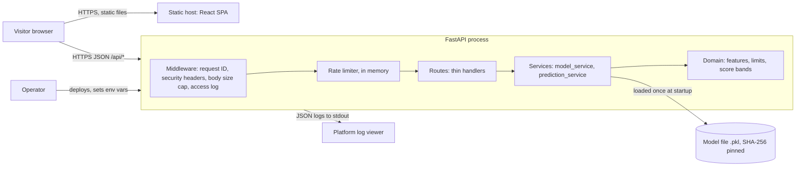

# Architecture

Status: draft v1, written before the code. Matches `docs/system-design.md`.

## Shape: a small modular monolith plus a static frontend

One FastAPI process holds everything server-side. The React app is a static bundle hosted separately
and talks to the API over HTTPS. There is no database, cache, queue or background worker (ADR 0002).



Every box and why it exists:

| Box | Why |
| --- | --- |
| Static host + React SPA | The UI is a form and a result view; it needs no server rendering. |
| Middleware | One place for request IDs, headers, size cap and the access log, so no route can forget them. |
| Rate limiter | Protects a CPU-bound endpoint from loops and scrapers. In memory, per instance (ADR 0004). |
| Routes | Parse and validate input, call a service, shape the response. No business logic. |
| Services | Load and verify the model, validate categories, run the prediction. |
| Domain | Plain Python: feature names, numeric limits, training ranges, score bands. No framework imports. |
| Model file | The only persistent asset. Verified by SHA-256 before it is unpickled (ADR 0003). |
| JSON logs | Operability without a log vendor. Inputs and IPs are never logged (ADR 0005). |

## Stack

| Layer | Choice | Alternative rejected, and why |
| --- | --- | --- |
| Backend | Python 3.11+, FastAPI, Uvicorn | Flask: no built-in request validation. Django: far more than needed. |
| Validation | Pydantic v2 (comes with FastAPI) | Hand-written checks: more code, more gaps. |
| ML runtime | scikit-learn, pandas, numpy, joblib | Exporting to ONNX: removes the version lock but changes the model; not worth it yet. |
| Frontend | React + TypeScript (strict) + Vite | Next.js: server rendering is unnecessary here. Streamlit: user chose React. |
| Styling | Hand-written CSS with design tokens | A component library: heavy for 8 components. |
| Tests | pytest (backend), Vitest + Testing Library + axe (frontend), Playwright (one e2e flow) | None rejected; all standard. |
| CI | GitHub Actions | None. |
| Hosting | Static host for the SPA, a small container/web service for the API | Kubernetes and similar: far too much for one stateless service. |

## Folder structure

```
mental-health-predictor/
├── CLAUDE.md, AGENTS.md          # project memory for coding agents (AGENTS.md is a copy)
├── README.md
├── backend/
│   ├── app/
│   │   ├── main.py               # create_app() factory, lifespan, wiring
│   │   ├── config.py             # env parsing and startup validation
│   │   ├── schemas.py            # request/response models
│   │   ├── errors.py             # AppError + standard error format
│   │   ├── logging_config.py     # JSON logs, redaction, request-ID context
│   │   ├── middleware.py         # request context, headers, size cap
│   │   ├── rate_limit.py
│   │   ├── domain/               # features.py, interpretation.py, exceptions.py
│   │   ├── services/             # model_service.py, prediction_service.py
│   │   └── routes/               # health.py, predict.py
│   ├── scripts/make_dev_model.py # trains a SYNTHETIC stand-in model for tests and local smoke runs
│   ├── models/                   # real model goes here (git-ignored)
│   └── tests/
├── frontend/                     # Vite + React + TS
├── docs/                         # this folder
├── brain/security/               # threat model, secrets, attack surface, checklist
└── .github/                      # CI workflow, Dependabot
```

## Background jobs

None. A prediction takes milliseconds and nothing is sent, exported or stored. If email, exports or
storage are added later, they become background jobs (playbook layer 5c).

## Third-party services

None at runtime. Build and ops tooling only: GitHub (source and CI), the chosen hosting provider(s),
package registries (PyPI, npm). Error tracking (for example Sentry) is deliberately not wired up yet;
see `docs/playbook-coverage.md`.

## The three riskiest decisions

1. **Unpickling a model file.** `joblib.load` runs arbitrary code if the file is malicious. Mitigations:
   the file comes only from the operator, its SHA-256 must match `MODEL_SHA256` in production, and the
   path is never user-controlled. Residual risk: whoever can change both the file and the env var.
2. **Hard version lock to scikit-learn.** A pickled pipeline from one scikit-learn version can behave
   differently, or fail, on another. The loader refuses mismatches instead of guessing.
3. **In-memory rate limiting.** It resets on deploy and is per instance, so two instances double the
   effective limit. Fine for one instance; move to Redis before scaling out (ADR 0004).
